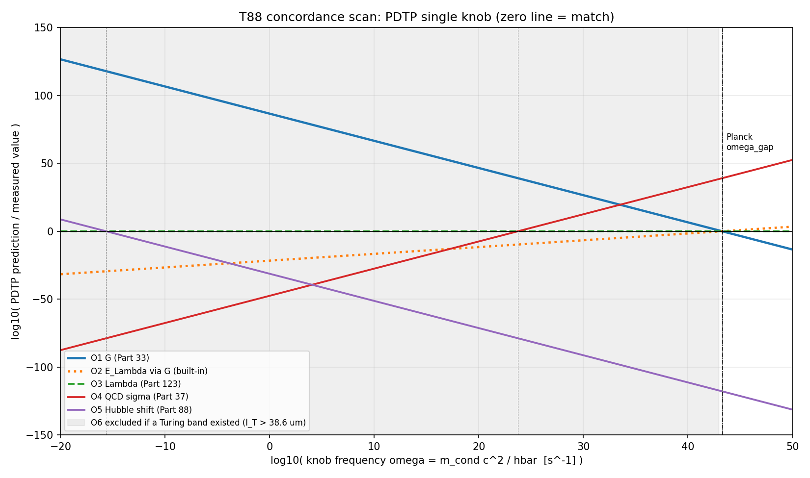

# Concordance Scan — Brute-Force Test of PDTP's Frequency Knob (T88)

**Status:** TOOL + FIRST RUN (2026-11-07, CLAUDE OPUS 5.5, at the user's request).
Not a physics Part: it adds no new equation. It plots the existing PDTP
predictions against one knob to see whether they agree.
**Tracked in:** TODO_05.md **T88**
**Script:** `simulations/solver/t88_concordance_scan.py` (log in `outputs/`)
**Scorecard:** 10 matches, 2 contradictions out of 12. The 2 contradictions
are the concordance failures.

---

## 1. Plain English

**The idea (user's question):** brute-force the calculation. Turn one knob,
a "ticking frequency", through every possible value, and see whether a single
setting explains several different measurements at once. In physics this is a
**parameter scan** or **grid search**. When it looks for one value that fits
many data at once it is called a **global fit** or **concordance test**. The
standard model of cosmology (ΛCDM) is the textbook success: 6 numbers fit the
CMB, galaxy clustering, supernovae and light-element abundances together.

**How to read the graph:** the horizontal axis is the knob, PDTP's condensate
frequency ω = m_cond c²/ℏ, over 70 orders of magnitude. Each line is one PDTP
prediction divided by its measured value, on a log scale. **Where a line crosses
zero, that prediction is right.** If several *independent* lines crossed zero
at the same spot, that spot would be special.

**What it shows:** PDTP's one knob is pinned by gravity (G) at the Planck
frequency. No other independent prediction crosses there. The QCD string
tension wants a frequency 19 decades lower (PDTP already says that is a
*second* condensate), and the Hubble-tension mechanism wants one 59 decades
lower (already known to fail). The cosmological-constant line is flat: the
knob cancels out of it, so it can never test the knob. The dark-energy line
*appears* to match at Planck, but it is a disguised copy of G. **No genuine
concordance with one knob.** That is what the earlier Parts already implied,
now visible in a single picture.

**Why the scan is still worth having:** by chance, three predictions would
line up within 1 decade somewhere in this range only **6 times in 10,000**.
So if a future PDTP version (a second, genuinely free frequency from T83i or
T87) ever produces a real three-way crossing, it would be strong evidence.
The tool is ready for that.

---

## 2. The Graph

*(File: `assets/images/t88_concordance_scan.png`, generated by the script.)*

---

## 3. The Frozen Observable List

Fixed **before** the first run, to avoid the look-elsewhere effect (trying
formulas until one fits). Each formula is taken exactly as its Part states it.

| # | PDTP prediction | Formula vs knob ω (m_cond = ℏω/c²) | Measured | Role |
|---|---|---|---|---|
| O1 | Newton's G (Part 33) | G = ℏc/m_cond² ∝ ω⁻² | CODATA G | independent anchor |
| O2 | dark-energy scale (T87 §6b) | E_Λ from ρ_Λ = Λc⁴/(8πG(ω)) ∝ ω^½ | 2.25 meV | **built-in copy of O1** (control) |
| O3 | cosmological constant (Part 123) | Λ = 3Ω_Λ(H₀/ω)²(ω/c)² ∝ ω⁰ | Planck Λ | knob cancels (Part 115) |
| O4 | QCD string tension (Part 37) | σ = C₂(ℏω)² ∝ ω² | 0.18 GeV² | independent |
| O5 | Hubble shift (Part 88/155) | δH₀/H₀ = (a₀/r_s)², a₀ = c/ω ∝ ω⁻² | 0.084 | independent (already NEGATIVE) |
| O6 | Turing spacing (T87, conditional) | ℓ_T = √(c²/(3H₀ω)) ∝ ω^(−½) | ≤ 38.6 μm (Eöt-Wash 95% CL) | one-sided limit (shading) |

---

## 4. Results (Data)

| | Crossing log₁₀ ω [s⁻¹] | Equivalent | Distance from O1 |
|---|---|---|---|
| O1 G | 43.27 | m_cond = m_P (Planck) | — |
| O2 E_Λ (built-in) | 43.27 | identical to O1 | 0 (by construction) |
| O3 Λ | none (flat at ratio 1.0000) | — | — |
| O4 QCD σ | 23.75 | m_cond = 367.4 MeV | **19.5 decades** |
| O5 Hubble | −15.64 | a₀ = 0.29 r_s | **58.9 decades** |
| O6 boundary | 42.96 | ℓ_T = 38.6 μm | Planck is 0.3 decades inside the allowed side (ℓ_T = 27.1 μm) |

**Null test (chance concordance):** for 3 crossings placed at random over 70
decades, P(all within 1 decade) = 3(1/70)² − 2(1/70)³ = **6.1 × 10⁻⁴** (Monte
Carlo 6.2 × 10⁻⁴; S11). A first version of this test shifted targets around
the current crossings and returned 0. That was not a calibration, so it was
replaced and documented in the code.

---

## 5. Sudoku Scorecard

| ID | Test | Computed | Expected | Result |
|---|---|---|---|---|
| S1 | O1 crosses at ω_P (1%) | 1.0000 | 1.0 | MATCH |
| S2 | O2 crossing = O1 (built-in flagged) | 0 dec | < 10⁻⁶ dec | MATCH |
| S3 | O3 flat (Part 115) | slope 2 × 10⁻²⁰ | 0 | MATCH |
| S4 | O3 level = Λ_obs (1%) | 1.0000 | 1.0 | MATCH |
| S5 | O4 crossing = 367 MeV (Part 37) | 367.4 MeV | 367 MeV | MATCH |
| S6 | O5 at ω_P = Part 88's 1.27 × 10⁻¹¹⁹ | 1.268 × 10⁻¹¹⁹ | 1.27 × 10⁻¹¹⁹ | MATCH |
| S7 | slopes −2 / +2 / −2 | −2 / 2 / −2 | −2 / 2 / −2 | MATCH |
| S8 | concordance O4–O1 ≤ 1 decade | 19.5 | ≤ 1 | CONTRADICTION |
| S9 | concordance O5–O1 ≤ 1 decade | 58.9 | ≤ 1 | CONTRADICTION |
| S10 | O6 at ω_P allowed | 27.1 μm | ≤ 38.6 μm | MATCH |
| S11 | null test: MC = exact formula | 6.20 vs 6.06 × 10⁻⁴ | equal | MATCH |
| S12 | chance concordance < 1% | 6.06 × 10⁻⁴ | < 0.01 | MATCH |

S1–S7 reproduce the source Parts' own numbers, so the scan is wired correctly.
S8–S9 are the finding: **no single-knob concordance**.

---

## 6. What the Visual Revealed `[SPECULATIVE where marked]`

1. **The duplicate trap is visible.** O2 crosses exactly where O1 does,
   because it is O1 in disguise. Any future "coincidence" must pass this test:
   does the second line depend on the knob *differently*?
2. **Flat lines are uninformative.** O3 (Λ) matches at every ω, so it cannot
   confirm or deny the knob. That is Part 115's scale-invariance no-go, made
   visible.
3. **Two crossings, two condensates.** G (Planck) and QCD (367 MeV) are
   19.5 decades apart. That is the existing two-condensate hypothesis
   (Parts 36–37), not a new failure.
4. **A concrete experimental target** `[SPECULATIVE, conditional on T87]`.
   The Eöt-Wash exclusion edge sits only 0.3 decades from Planck. If T87 ever
   shows PDTP has a genuine Turing band with Planck-rate reactions, its 27 μm
   spacing is about 1.4× below the current 38.6 μm limit. The next generation
   of sub-mm gravity tests would reach it.

---

## 7. Next Steps (T88)

1. **Second knob.** When T83i (matter's intrinsic frequency) or T87 (Turing
   reaction rate) produces a genuinely free frequency, add its predictions to
   a *new frozen list* and rerun. A 2-D scan (both knobs) would show crossings
   as lines on a map, and concordance as a point where several lines meet.
2. Keep the duplicate and flat-line controls in every future run.

---

## Sources

- CODATA 2018 (G, ℏ, m_P); Planck 2018 VI, [arXiv:1807.06209](https://arxiv.org/abs/1807.06209)
  (H₀ = 67.66, Ω_Λ = 0.6889, Λ = 1.1056 × 10⁻⁵² m⁻²)
- Lee, J.G. et al. (2020), *Phys. Rev. Lett.* 124, 101101, [arXiv:2002.11761](https://arxiv.org/abs/2002.11761)
  (Yukawa range < 38.6 μm at 95% CL)
- PDTP Parts 33, 37, 88, 115, 123, 155; T87 note
  [turing_morphogenesis_note.md](turing_morphogenesis_note.md)
- Range of n uniform random points (order statistics): standard result,
  checked here by Monte Carlo (S11)
