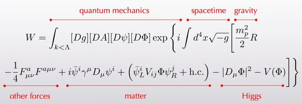

# Part 148 — The "Theory of Everything" Master Equation: A Term-by-Term Explainer

**Phase:** 148 — pure explainer (no script; nothing derived or verified here)
**Date:** 2026-09-14
**Status:** T79 PHASE 1 of 2. **This document explains the equation and every
term in it — nothing more.** It contains no PDTP content and makes no
comparison to PDTP's own status on any term. **T79 Phase 2** (auditing
PDTP against each piece, and asking whether PDTP's own version of any
term should update the framework) is a **separate, later pass**, only to
begin after this document has been reviewed. This split, and the
"extra careful" instruction it comes with, are the user's own explicit
request for this item.
**Scope note:** per CLAUDE.md, this document keeps interpretation
(Section 6's honest limitations) separated from the established-physics
content (Sections 3-5), and every term below is cited to a real, checked
source — see Section 7.

---

## 1. Where This Equation Comes From

**Source:** a Quora answer to "Do we have the theory of everything? If
yes, then what is the equation?"
(https://www.quora.com/Do-we-have-the-theory-of-everything-If-yes-then-what-is-the-equation)
— image saved locally at
`assets/images/main-qimg-54f863a4dcc66a6be61caf1d89691959-lq.jpg`
(flagged by the user, `docs/misc/note 2026-09-14.txt`).



*(Image served from GitHub directly, not a local relative path — see the
note below if you're reading this before it's pushed, or offline.)*

This specific combination — the Einstein–Hilbert gravity action plus the
full Standard Model Lagrangian, written as one path integral — is a
widely-circulated way of answering "what is the one equation for
everything we currently understand?" It is **not** a single paper's
result and **not** itself a claim that quantum gravity has been solved;
it is a compact, standard way of writing "gravity's equation" and
"particle physics's equations" side by side in one expression. Every
individual piece is real, established, textbook physics — see Section 7
for the source of each piece individually.

---

## 2. The Honest Caveat, Stated Up Front

**This must be understood before reading Sections 3-5, not after.**

Writing the Einstein–Hilbert action and the Standard Model Lagrangian
inside the same functional integral does **not** unify them into a
single working theory of quantum gravity:

1. **The gravity piece is not renormalizable this way.** Ordinary
   quantum-field-theory techniques (used successfully for the other
   terms) break down when applied to the `R` term's own path integral —
   this is *the* central unsolved problem of theoretical physics, not
   something this equation resolves by being written down.
2. **The couplings are not unified.** The strengths of gravity, the
   strong force, and the electroweak force (the numbers multiplying each
   bracket) remain three independent, experimentally-measured inputs in
   this expression — nothing here explains why they have the values
   they do, or predicts a single common origin for them.
3. **Several well-known open problems are simply absent from it**,
   because the Standard Model itself doesn't address them: neutrino
   masses (the SM as written here has none), dark matter, dark energy
   (beyond a possible constant term hidden inside `V(Φ)`), the number of
   fermion generations (`i,j` just runs over "however many there are"),
   and the strong-CP problem.

**The most accurate way to describe this equation:** a compact
**checklist** of everything a complete, established fundamental theory
must currently contain — gravity, all measured forces, all known matter,
the mass-generation mechanism — written in one place for convenience,
not a solved unified answer. This framing is exactly why it is useful as
an audit tool (T79 Phase 2's purpose): it names every piece a rival or
extending theory needs to have *something to say about*, without itself
claiming those pieces are unified.

---

## 3. The Full Equation

Transcribed directly from the source image, including the momentum
cutoff subscript often left out of casual restatements of this equation.
Three equivalent versions are given, each useful in a different context:

**Typeset (LaTeX), for viewers that render math** — GitHub's own web
view renders this automatically, as does VS Code's built-in Markdown
preview (`Ctrl+Shift+V` / the preview-pane icon) and any other
KaTeX/MathJax-aware viewer. If your current viewer shows raw `$$...$$`
text instead of a typeset equation, it simply isn't running a math
renderer — see the note at the end of this section for what that means
and what to do about it:

$$
W = \int_{k<\Lambda} [\mathcal{D}g][\mathcal{D}A][\mathcal{D}\psi][\mathcal{D}\Phi] \, \exp\left\{ i \int d^4x \sqrt{-g} \left[ \frac{m_p^2}{2} R - \frac{1}{4} F^a_{\mu\nu} F^{a\mu\nu} + i \bar{\psi}^i \gamma^\mu D_\mu \psi^i + \left( \bar{\psi}_L^i V_{ij} \Phi \psi_R^j + \text{h.c.} \right) - |D_\mu \Phi|^2 - V(\Phi) \right] \right\}
$$

**As the original image** (embedded in Section 1 above) — shows the
source's own six hand-drawn labels directly.

**Plain-text fallback** (no image or math rendering required at all —
readable in a bare terminal, `cat`, or `grep`):

```
                    quantum mechanics      spacetime  gravity
                  |______________________||_________||______|

W = Int_{k<Λ} [Dg][DA][Dψ][DΦ] exp{ i Int d^4x sqrt(-g) [ (m_p^2/2) R

      - (1/4) F^a_μν F^{aμν} + i ψbar^i γ^μ D_μ ψ^i

      + ( ψbar_L^i V_ij Φ ψ_R^j + h.c. ) - |D_μ Φ|^2 - V(Φ) ] }

  |___________________||_________________________||_______|
      other forces              matter               Higgs
```

**What LaTeX is, briefly** (asked in chat — kept here too since it
explains why this section has three versions of one equation): LaTeX is
the standard typesetting language the physics/math community uses to
write equations — instead of drawing symbols, you write plain-text
markup like `\frac{m_p^2}{2}` and a renderer turns it into a properly
formatted fraction, and so on for integrals, Greek letters, sub/super-
scripts, etc. It's not a PDTP-specific tool; it's the same system nearly
every physics paper (including every one cited in this project's own
`glossary_sources.md`) is typeset in. The `$$...$$` block above *is*
that markup — copy the text between the `$$` marks to reuse the equation
anywhere else that understands LaTeX math (another `.md` file, a LaTeX
document, many chat/notebook interfaces).

**Plain English:** `W` is a single number (technically, a functional)
computed by adding up a weighted contribution from *every possible*
configuration of spacetime and every field in it, weighted by
`exp(i × action)`. This is the standard machine of quantum field theory
— the **path integral** — applied simultaneously to gravity and to every
known particle field. The six labels above split the expression into
the six conceptual pieces this document explains one at a time
(Sections 4.1-4.6).

---

## 4. Term-by-Term Breakdown

### 4.1 "Quantum Mechanics" — the Path-Integral Machinery

```
W = Int_{k<Λ} [Dg][DA][Dψ][DΦ] exp{ i Int d^4x sqrt(-g) [ ... ] }
```

This whole apparatus — not any single symbol inside the brackets — is
what the top label "quantum mechanics" points to: it is the **path
integral formulation** of quantum theory, generalizing the classical
principle of least action into a weighted sum over *every* possible
history a system could take, not just the one that extremizes the
action classically.
**Source:** [Path integral formulation — Wikipedia](https://en.wikipedia.org/wiki/Path_integral_formulation)

- **`W`** — the generating functional (partition function) of the
  theory. Physical quantities (particle-scattering probabilities,
  correlation functions) are extracted from it by differentiating with
  respect to source terms not shown here — a standard QFT technique.
- **`Int_{k<Λ}`** — the integral carries a **momentum cutoff**: only
  field configurations with momentum modes `k` below some scale `Λ` are
  included. This is a **Wilsonian effective-field-theory** notation —
  it is an explicit admission that this expression is understood to be
  valid only up to some energy scale `Λ` (often taken to be near the
  Planck scale), *not* a claim that it holds at arbitrarily high energy.
  This detail is easy to drop when the equation is quoted casually, but
  it is present in the source image and matters for Section 2's caveat:
  the cutoff is precisely where new, currently-unknown physics (a real
  quantum-gravity completion) would have to take over.
  **Source:** [Effective field theory — Wikipedia](https://en.wikipedia.org/wiki/Effective_field_theory),
  [Renormalization group — Wikipedia](https://en.wikipedia.org/wiki/Renormalization_group)
- **`[Dg][DA][Dψ][DΦ]`** — the path-integral **measure**: "sum over
  every possible configuration of," respectively, the spacetime metric
  `g` (gravity), the gauge fields `A` (all the force-carrying fields
  collectively — photon, W/Z bosons, gluons), the fermion fields `ψ`
  (matter — quarks and leptons), and the Higgs field `Φ`.
- **`exp{ i Int d^4x sqrt(-g) [ ... ] }`** — the Feynman weight
  `exp(iS)`, where `S = Int d^4x sqrt(-g) L` is the classical **action**
  (the integral of the Lagrangian density `L`, the bracketed content of
  Sections 4.2-4.6, over all of spacetime). Every possible field
  configuration contributes to `W`, weighted by this complex phase — the
  configurations near the classical solution (where the action is
  stationary) dominate in the classical limit, which is how ordinary
  classical physics re-emerges from this fully quantum expression.

### 4.2 "Spacetime" — the Volume Element

```
Int d^4x sqrt(-g)
```

- **`d^4x`** — an infinitesimal element of four-dimensional spacetime
  (three space directions plus time).
- **`sqrt(-g)`** — the square root of minus the determinant of the
  metric tensor `g_μν`. This factor is what makes `d^4x sqrt(-g)` an
  invariant volume element — one that gives the same physical volume
  regardless of which coordinate system is used to describe the same
  patch of curved spacetime. (The minus sign is a signature convention:
  with a `(+,-,-,-)` metric signature, `det(g)` is negative, so
  `sqrt(-g)` is what stays real and positive.) Multiplying every term in
  the Lagrangian by `sqrt(-g)` is what makes the whole action a genuine,
  coordinate-independent scalar — required for General Relativity's
  equations to take the same form in every coordinate system.
  **Source:** [Einstein–Hilbert action — Wikipedia](https://en.wikipedia.org/wiki/Einstein%E2%80%93Hilbert_action)
  (the `sqrt(-g)` factor is introduced and explained there in the
  gravity context this equation borrows it from).

### 4.3 "Gravity" — the Einstein–Hilbert Term

```
(m_p^2 / 2) * R
```

This is the **Einstein–Hilbert action**'s integrand — the single term
whose variation (with respect to the metric `g_μν`) produces Einstein's
field equations of General Relativity.
**Source:** [Einstein–Hilbert action — Wikipedia](https://en.wikipedia.org/wiki/Einstein%E2%80%93Hilbert_action)

- **`R`** — the **Ricci scalar curvature**: a single real number at
  every point in spacetime, obtained by fully contracting (tracing) the
  Riemann curvature tensor. It is the simplest scalar that can be built
  from the metric's curvature, and General Relativity is, in this
  precise sense, "the simplest possible theory of a dynamical
  spacetime."
  **Source:** [Scalar curvature — Wikipedia](https://en.wikipedia.org/wiki/Scalar_curvature)
- **`m_p`** — the (reduced) **Planck mass**, `m_p = sqrt(hbar*c/(8*pi*G))`
  in the reduced convention used here — the natural mass scale built
  from Newton's constant `G`, the speed of light `c`, and the reduced
  Planck constant `hbar`. It sets the overall strength (normalization)
  of the gravity term — equivalently, how "stiff" spacetime is against
  being curved by a given amount of energy.
  **Source:** [Planck mass — Wikipedia](https://en.wikipedia.org/wiki/Planck_mass)

### 4.4 "Other Forces" — the Yang–Mills (Gauge Field) Term

```
- (1/4) * F^a_μν * F^{aμν}
```

This is the standard **Yang–Mills** kinetic term for every gauge
(force-carrying) field in the Standard Model at once — the electroweak
`SU(2) x U(1)` fields and the strong-force `SU(3)` gluon fields — packed
into a single compact expression by letting the index `a` run over all
the generators of the full `SU(3) x SU(2) x U(1)` gauge group (12
generators total: 8 for `SU(3)`/gluons, 3 for `SU(2)`, 1 for `U(1)`,
before electroweak symmetry breaking mixes the last two into the
familiar photon, `W`, and `Z` bosons).
**Source:** [Yang–Mills theory — Wikipedia](https://en.wikipedia.org/wiki/Yang%E2%80%93Mills_theory)

- **`F^a_μν`** — the **field-strength tensor** for gauge field `a`:
  `F^a_μν = ∂_μ A^a_ν − ∂_ν A^a_μ + g f^{abc} A^b_μ A^c_ν`. The first two
  terms are a direct generalization of the ordinary electromagnetic
  field strength; the third term (present only for *non-abelian* gauge
  groups like `SU(2)` and `SU(3)`, absent for plain `U(1)` electromagnetism)
  makes the gauge fields interact directly with themselves — the source
  of gluon self-interaction and asymptotic freedom in QCD.
- **`F^{aμν}`** — the same tensor with both indices raised (via the
  metric), so that `F^a_μν F^{aμν}` is a genuine Lorentz scalar summed
  over both spacetime indices and the gauge index `a`.
- **`-1/4`** — the conventional normalization that gives the gauge
  field's kinetic term the standard, canonically-normalized form (the
  same role `1/2` plays in an ordinary scalar field's kinetic term
  `(1/2)(∂φ)^2`).

### 4.5 "Matter" — the Dirac Kinetic Term and the Yukawa Coupling

This label spans **two** distinct terms in the source image: the
fermion kinetic term and the Yukawa (mass-generating) coupling.

**4.5a — Dirac kinetic term:**

```
i * ψbar^i * γ^μ * D_μ * ψ^i
```

This is the standard relativistic kinetic (and gauge-interaction) term
for every matter fermion (quark and lepton) field at once, with `i`
indexing the field's flavor/generation (up quark, down quark, electron,
electron neutrino, and their heavier-generation counterparts).
**Source:** [Dirac equation — Wikipedia](https://en.wikipedia.org/wiki/Dirac_equation)

- **`ψ^i`** — the `i`-th fermion field (a **Dirac spinor**, a
  four-component object that encodes a spin-1/2 particle and its
  antiparticle together).
- **`ψbar^i`** — the **Dirac adjoint**, `ψbar = ψ† γ^0`, needed so that
  the kinetic term is a proper Lorentz scalar and produces a
  positive-definite probability density.
- **`γ^μ`** — the **gamma matrices** (Dirac matrices): four fixed
  matrices satisfying the Clifford algebra `{γ^μ,γ^ν}=2η^{μν}`, which is
  precisely what makes the Dirac equation compatible with special
  relativity.
  **Source:** [Gamma matrices — Wikipedia](https://en.wikipedia.org/wiki/Gamma_matrices)
- **`D_μ`** — the **gauge-covariant derivative**: an ordinary derivative
  `∂_μ` plus extra terms built from the gauge fields `A^a_μ` (Section
  4.4), with coefficients set by each fermion's own charge under
  `SU(3) x SU(2) x U(1)`. This is precisely how matter fields couple to
  the force-carrying fields — the *only* place `A^a_μ` and `ψ^i` talk to
  each other in this whole expression.
  **Source:** [Gauge covariant derivative — Wikipedia](https://en.wikipedia.org/wiki/Gauge_covariant_derivative)

**4.5b — Yukawa coupling:**

```
( ψbar_L^i * V_ij * Φ * ψ_R^j + h.c. )
```

**Source:** [Yukawa interaction — Wikipedia](https://en.wikipedia.org/wiki/Yukawa_interaction)

- **`ψ_L^i`, `ψ_R^j`** — the **left-handed** and **right-handed
  chirality** components of the fermion fields. In the Standard Model,
  left- and right-handed fermions carry *different* charges under
  `SU(2) x U(1)` (left-handed fermions come in weak-isospin doublets;
  right-handed fermions are singlets) — this is why they must be
  written separately here, unlike in the kinetic term above.
  **Source:** [Chirality (physics) — Wikipedia](https://en.wikipedia.org/wiki/Chirality_(physics))
- **`V_ij`** — the **Yukawa coupling matrix**: a matrix of coupling
  constants between generations `i` and `j`. Its eigenvalues, once the
  Higgs field acquires its vacuum value (Section 4.6), become the
  fermion masses; the *mismatch* between the matrix that diagonalizes
  the up-type quark sector and the one that diagonalizes the down-type
  sector is exactly the origin of the **CKM (quark-mixing) matrix**.
  **Source:** [Cabibbo–Kobayashi–Maskawa matrix — Wikipedia](https://en.wikipedia.org/wiki/Cabibbo%E2%80%93Kobayashi%E2%80%93Maskawa_matrix)
- **`Φ`** — the Higgs field (Section 4.6) — its presence is exactly what
  makes this term gauge invariant, despite connecting two fermion fields
  of different `SU(2) x U(1)` charge: the Higgs field's own charge
  precisely cancels the mismatch.
- **`h.c.`** — "**Hermitian conjugate**": shorthand meaning "add this
  same term again with a dagger on every field/matrix," which is
  required to make the overall Lagrangian real-valued (a physical
  requirement — the action must be a real number).

**Why this term exists at all — a physically important point:** a bare
mass term for a Standard Model fermion (something like `m * ψbar*ψ`
without any Higgs field) is *not* gauge invariant, because it would
directly connect a left-handed field to a right-handed field of
different `SU(2) x U(1)` charge. The Yukawa term is the Standard Model's
*only* way around this — it is not an alternative to a "simpler" mass
term, it is the mechanism the gauge symmetry itself requires.

### 4.6 "Higgs" — Kinetic Term and Potential

```
- |D_μ Φ|^2 - V(Φ)
```

**Source:** [Higgs mechanism — Wikipedia](https://en.wikipedia.org/wiki/Higgs_mechanism)

- **`Φ`** — the Higgs field, a complex scalar field carrying `SU(2) x
  U(1)` charge.
- **`D_μ Φ`** — the Higgs field's own gauge-covariant derivative
  (same `D_μ` construction as Section 4.5a, applied to the Higgs
  field's own charge assignment). Expanding `|D_μΦ|^2` out is exactly
  where the `W` and `Z` boson mass terms come from once `Φ` acquires its
  nonzero vacuum value — this expansion is *the* Higgs mechanism.
- **`V(Φ)`** — the Higgs **potential**, conventionally
  `V(Φ) = -μ² |Φ|² + λ|Φ|⁴` — the "Mexican hat" (or "wine bottle")
  potential whose shape (a maximum, not a minimum, at `Φ=0`) is what
  forces the field to settle at a nonzero value everywhere in the
  vacuum, spontaneously breaking the electroweak symmetry and, via the
  Yukawa term (Section 4.5b), giving every Standard Model fermion its
  mass.

---

## 5. Every Symbol, In One Place

| Symbol | Meaning | Explained in |
|---|---|---|
| `W` | Generating functional (partition function) of the full theory | 4.1 |
| `Int_{k<Λ}` | Path integral with a Wilsonian momentum cutoff Λ | 4.1 |
| `[Dg]` | Path-integral measure over spacetime metric configurations | 4.1 |
| `[DA]` | Path-integral measure over gauge (force) field configurations | 4.1 |
| `[Dψ]` | Path-integral measure over fermion (matter) field configurations | 4.1 |
| `[DΦ]` | Path-integral measure over Higgs field configurations | 4.1 |
| `d^4x` | Four-dimensional spacetime volume element | 4.2 |
| `sqrt(-g)` | Invariant volume factor (square root of minus the metric determinant) | 4.2 |
| `m_p` | (Reduced) Planck mass — sets gravity's overall strength | 4.3 |
| `R` | Ricci scalar curvature of spacetime | 4.3 |
| `F^a_μν` | Field-strength (curvature) tensor of gauge field `a` | 4.4 |
| `a` | Index over all `SU(3)xSU(2)xU(1)` gauge-group generators (12 total) | 4.4 |
| `ψ^i` | Fermion (matter) field, generation/flavor `i` | 4.5a |
| `ψbar^i` | Dirac adjoint of `ψ^i` | 4.5a |
| `γ^μ` | Gamma (Dirac) matrices | 4.5a |
| `D_μ` | Gauge-covariant derivative | 4.5a, 4.6 |
| `ψ_L^i`, `ψ_R^j` | Left-/right-handed chirality components of the fermion fields | 4.5b |
| `V_ij` | Yukawa coupling matrix (generation indices `i,j`) | 4.5b |
| `h.c.` | "Hermitian conjugate" — add the dagger-conjugated term too | 4.5b |
| `Φ` | The Higgs field | 4.5b, 4.6 |
| `V(Φ)` | The Higgs potential ("Mexican hat") | 4.6 |
| `μ, λ` | Higgs potential parameters (mass term, self-coupling) | 4.6 |

---

## 6. What This Equation Does and Doesn't Claim (Recap)

Restating Section 2 slightly more fully, now that every term has been
defined, so this is available as a direct, checkable reference for T79
Phase 2:

**What it correctly represents:** every individually-established piece
of fundamental physics currently confirmed by experiment — General
Relativity's field equations (via the `R` term), the electroweak and
strong forces (via the `F^2` term), all known matter (via the Dirac
term), the CKM quark-mixing structure and all fermion masses (via the
Yukawa term), and electroweak symmetry breaking (via the Higgs
potential) — combined into one self-consistent, if only symbolically
unified, expression.

**What it does not claim or resolve, honestly:**
- A working, renormalizable theory of quantum gravity (the `R` term's
  own path integral is not well-defined at high energy the way the
  other terms are — this is the reason for the `k<Λ` cutoff in Section 4.1).
- Unification of the three force strengths into a single coupling.
- Neutrino masses (absent from this exact form — the Standard Model as
  written here predicts massless neutrinos; extending the Yukawa sector
  to include them is a real, separate, well-known addition).
- Dark matter, dark energy (beyond whatever constant sits inside `V(Φ)`),
  the number of fermion generations, or the strong-CP problem.

**T79 Phase 2's task** (not started in this document) will be to take
each of Sections 4.3-4.6's four labeled physics pieces (gravity, other
forces, matter+Yukawa, Higgs) plus Section 4.1's "quantum mechanics"
framing, and map PDTP's own current status against each one individually
— term by term, exactly as this document has broken the equation down —
per T79's own filing in `TODO_04.md`.

---

## 7. Sources

- **Source (context):** [Quora — "Do we have the theory of everything?"](https://www.quora.com/Do-we-have-the-theory-of-everything-If-yes-then-what-is-the-equation)
  (image saved locally, `assets/images/main-qimg-54f863a4dcc66a6be61caf1d89691959-lq.jpg`).
- **Source:** [Path integral formulation — Wikipedia](https://en.wikipedia.org/wiki/Path_integral_formulation)
- **Source:** [Effective field theory — Wikipedia](https://en.wikipedia.org/wiki/Effective_field_theory)
- **Source:** [Renormalization group — Wikipedia](https://en.wikipedia.org/wiki/Renormalization_group)
- **Source:** [Einstein–Hilbert action — Wikipedia](https://en.wikipedia.org/wiki/Einstein%E2%80%93Hilbert_action)
- **Source:** [Scalar curvature — Wikipedia](https://en.wikipedia.org/wiki/Scalar_curvature)
- **Source:** [Planck mass — Wikipedia](https://en.wikipedia.org/wiki/Planck_mass)
- **Source:** [Yang–Mills theory — Wikipedia](https://en.wikipedia.org/wiki/Yang%E2%80%93Mills_theory)
- **Source:** [Dirac equation — Wikipedia](https://en.wikipedia.org/wiki/Dirac_equation)
- **Source:** [Gamma matrices — Wikipedia](https://en.wikipedia.org/wiki/Gamma_matrices)
- **Source:** [Gauge covariant derivative — Wikipedia](https://en.wikipedia.org/wiki/Gauge_covariant_derivative)
- **Source:** [Yukawa interaction — Wikipedia](https://en.wikipedia.org/wiki/Yukawa_interaction)
- **Source:** [Chirality (physics) — Wikipedia](https://en.wikipedia.org/wiki/Chirality_(physics))
- **Source:** [Cabibbo–Kobayashi–Maskawa matrix — Wikipedia](https://en.wikipedia.org/wiki/Cabibbo%E2%80%93Kobayashi%E2%80%93Maskawa_matrix)
- **Source:** [Higgs mechanism — Wikipedia](https://en.wikipedia.org/wiki/Higgs_mechanism)
- **Source:** [Mathematical formulation of the Standard Model — Wikipedia](https://en.wikipedia.org/wiki/Mathematical_formulation_of_the_Standard_Model)
  (the single best broader reference covering the full combined
  Lagrangian, all terms of Sections 4.4-4.6 together, in one place).
- **Source:** [Standard Model — Wikipedia](https://en.wikipedia.org/wiki/Standard_Model)

All URLs above were verified to resolve to the correct article before
being included, per CLAUDE.md's URL Rules — none were guessed.

---

*This document is Phase 1 of T79 (TODO_04.md) — a pure explainer, no
PDTP comparison. See `TODO_04.md` T79 for the current status of Phase 2.*